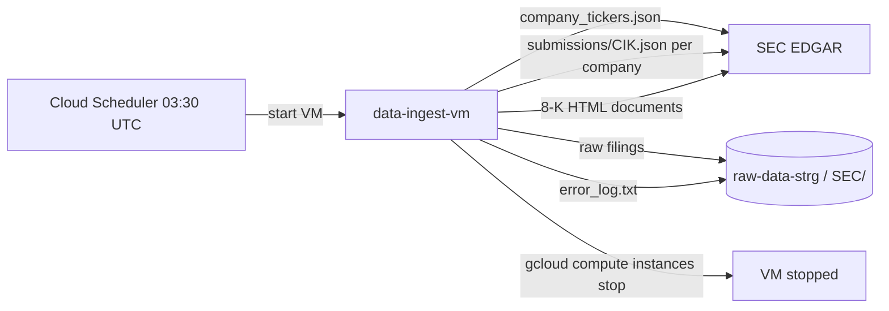

# SEC 8-K Ingestion Pipeline (GCP VM)

Automates daily retrieval of SEC Form **8-K** filings for Fortune 500 companies. A transient GCE VM boots on schedule, delta-scans the Submissions API, uploads raw documents to Cloud Storage, and shuts itself down.

**No production processes are started from this repository automatically.**

## Architecture



## Data strategy

### 1. Target roster (~500 companies)

Each run loads the target ticker list from **`gs://raw-data-strg/SEC/config/fortune500.json`**.

If that file is missing, the pipeline bootstraps it from `FORTUNE_500_FALLBACK_URL` (S&P 500 constituents CSV — a practical proxy for large-cap US companies) and saves it to GCS for future runs.

Replace `fortune500.json` in GCS with an official Fortune 500 JSON when you have one; same format:

```json
{ "tickers": ["AAPL", "MSFT", "..."] }
```

### 2. SEC CIK cross-reference (every run)

Fetch [company_tickers.json](https://www.sec.gov/files/company_tickers.json) and map each target ticker → `cik_str`.

### 3. Roster change detection

Compare the current target list to `SEC/logs/fortune500_roster.json` from the previous run. Log additions/removals (e.g. companies entering or leaving the top 500).

### 4. Daily delta-scan + GCS dedup

For each resolved CIK:

- Query `submissions/CIK.json` for 8-Ks in the lookback window (7 days first run, 24 hours after)
- **Skip** any filing already in `gs://raw-data-strg/SEC/8-K/...`
- **Upload only** new 8-K documents

The cron job does not re-download the full history every day — only what is new or changed in the window.

## Project defaults (`ftd2026`)

| Setting | Value |
|---|---|
| GCP Project | `ftd2026` |
| VM Name | `data-ingest-vm` |
| Zone | `us-west2-a` |
| Bucket | `raw-data-strg` |
| User-Agent | `FinanceTrackerDashboard izzybutera11@gmail.com` |
| Scheduler | Daily **03:30 UTC** |

## GCS layout

```
gs://raw-data-strg/SEC/
  8-K/{CIK}/{accession}/{primary_document}
  8-K/{CIK}/{accession}/metadata.txt
  logs/error_log.txt
  logs/last_successful_run.json
```

## Guardrails

- Per-CIK Submissions API delta-scan (default)
- User-Agent on every SEC request; ≤10 req/s; 3 retries
- VM self-stops in a `finally` block
- Refuses to run off-GCP unless `ALLOW_LOCAL_EXECUTION=true`

## Deployment (manual — run when ready)

Run all commands from the **`sec/`** directory:

```bash
cd sec
bash scripts/provision_vm.sh
bash scripts/install_dependencies.sh   # on the VM after copying code
cp .env.example .env
# Attach scripts/vm_startup.sh as instance startup-script metadata
SCHEDULER_SERVICE_ACCOUNT=your-sa@ftd2026.iam.gserviceaccount.com \
  bash scripts/setup_cloud_scheduler.sh
```

To push local changes to the VM:

```bash
cd sec
bash scripts/deploy_to_vm.sh
```

Grant the VM service account **Storage Object Admin** on `raw-data-strg`.
